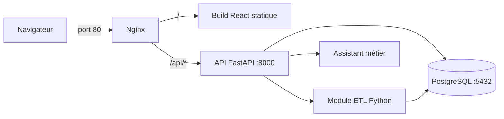
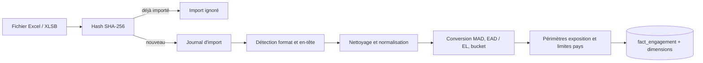

# 📊 Plateforme décisionnelle BCP — Dashboard de suivi des engagements

> Plateforme web pour **automatiser, centraliser et visualiser** le suivi des engagements et des indicateurs de risque des banques et filiales du Groupe Banque Centrale Populaire à l'international.


**Projet de Stage d'été II** · ENSA El Jadida (filière ISIC) · Banque Centrale Populaire, Casa Finance City

---

## 🎥 Démonstration

▶️ [**Voir la vidéo de démonstration**](https://drive.google.com/file/d/1MSTP3eF4QJw0ZQ8TBuDGKSvn2zDOW7Qb/view?usp=drive_link)

---

## 📋 Contexte

Ce projet a été réalisé lors de mon stage de **2 mois (03/07/2026 – 31/08/2026)** au sein du **Département Surveillance Banques & Filiales à l'International**, rattaché au Pôle Risques Groupe de la Banque Centrale Populaire (BCP), à Casa Finance City (Casablanca).

Le département assure la surveillance consolidée du risque de crédit des filiales et succursales du Groupe à l'international. Il centralise les données remontées par chaque entité et produit des dashboards de suivi (encours, EAD, provisions) et de leur évolution, pour appuyer le reporting auprès de la Direction des Risques.

### Problématique

> Comment concevoir une plateforme sécurisée permettant d'automatiser l'importation, le traitement, la centralisation, l'analyse et la visualisation des données nécessaires au suivi des risques des banques, filiales et participations à l'international ?

### Limites du processus existant

| Constat | Conséquence |
|---|---|
| Données issues de sources multiples (fichiers Excel / XLSB) | Opérations d'adaptation et de contrôle répétées |
| Traitements manuels et répétitifs | Temps de préparation important, risque d'erreur humaine |
| Historique difficile à exploiter | Comparaisons entre dates d'arrêté laborieuses |
| Absence d'interface décisionnelle centralisée | Multiplication des supports et des outils |
| Gestion des accès à structurer | Besoin d'authentification et de rôles |

### Pourquoi une plateforme sur mesure ?

| Critère | Fichiers manuels | Solution BI (Power BI) | **Plateforme sur mesure** |
|---|---|---|---|
| Automatisation | Faible | Élevée | **Élevée** |
| Règles métier spécifiques | Manuelle | Dépendante de l'outil | **Très flexible** |
| Licences payantes | Non | Oui | **Non (stack open source)** |
| Déploiement local / confidentialité | Oui | Contraint | **100 % local** |
| Assistant IA | Limité | Variable | **Maîtrisé** |

> L'objectif n'était pas de remettre en cause les règles métier existantes, mais de les intégrer dans une solution automatisée.

---

## ✨ Fonctionnalités

- 📥 **Import de fichiers sources** Excel / XLSB (base, devises, rating) avec suivi de progression en arrière-plan
- 🔁 **Détection des doublons** par empreinte **SHA-256** : un fichier déjà traité n'est jamais retraité
- ⚙️ **Pipeline ETL automatisé** : détection du format, nettoyage, normalisation, conversion en **MAD**, calcul de **EAD MAD** et **EL MAD**, calcul du **bucket** (indicateurs b1, b2, b3), périmètre d'exposition et périmètre limites pays
- 🗄️ **Centralisation et historisation** dans PostgreSQL (modèle en étoile)
- 📅 **Comparaisons temporelles automatiques** : T0, T-1, N-1 et arrêté annuel
- 📊 **6 dashboards interactifs** avec filtres, recherche et changement de date d'arrêté
- ✏️ **Mode édition** des données (selon permissions) avec journal des modifications
- 📤 **Exports** Excel, PDF et PowerPoint
- 🤖 **Assistant métier** (« BCP Intelligent Assistant ») : questions en langage naturel, génération de rapports
- 🔐 **Authentification JWT**, rôles et permissions (importer / modifier / exporter), espace d'administration
- 🧾 **Traçabilité** : journaux des imports, des modifications, des accès et des requêtes de l'assistant

### Dashboards

| Dashboard | Objectif |
|---|---|
| Segmentation | Répartition des engagements par segment |
| Rating Pays | Analyse selon la notation des pays |
| Zones | Répartition géographique |
| Types | Dashboard personnalisé (dimensions et mesures au choix) |
| Souverains | Suivi des engagements souverains par catégorie |
| Encours Souverains | Évolution des encours souverains |

### Gestion des dates d'arrêté

La date sélectionnée par l'utilisateur est la référence **T0** ; les autres périodes sont déduites automatiquement.

| Référence | Définition | Exemple (T0 = 30/06/2026) |
|---|---|---|
| T0 | Date d'arrêté sélectionnée | 30/06/2026 |
| T-1 | Arrêté du trimestre précédent | 31/03/2026 |
| N-1 | Même date, année précédente | 30/06/2025 |
| Arrêté annuel | 31 décembre de l'année précédente | 31/12/2025 |

---

## 🏗️ Architecture



Seul **Nginx** est exposé (port 80). FastAPI et PostgreSQL ne sont accessibles que depuis le réseau interne créé par Docker Compose. Le frontend n'accède **jamais** directement à la base : tous les contrôles d'accès et règles métier passent par l'API.

### Pipeline ETL



### Assistant métier

L'assistant **ne génère jamais de SQL libre**. Un orchestrateur détecte l'intention et les entités (date, segment, métrique), puis appelle un **outil métier prédéfini** (liste blanche) qui exécute une requête paramétrée. La base reste la source de vérité, et chaque interrogation est journalisée (`ai_logs`).

### Modèle de données

Modèle **en étoile** autour de la table de faits `fact_engagement` :

| Catégorie | Tables |
|---|---|
| Faits | `fact_engagement` |
| Dimensions | `dim_filiale`, `dim_devise`, `dim_segment`, `dim_secteur_activite`, `dim_rating_pays` |
| Taux | `taux_change` |
| Import | `journal_import`, `fichier_source` |
| Sécurité et traçabilité | `utilisateur`, `journal_acces`, `journal_modifications`, `ai_logs` |

---

## 🛠️ Stack technique

| Couche | Technologies |
|---|---|
| Frontend | React, Vite |
| Backend / API REST | Python, FastAPI |
| ETL | Python, Pandas, NumPy, pyxlsb |
| Base de données | PostgreSQL |
| Serveur web / reverse proxy | Nginx |
| Conteneurisation | Docker, Docker Compose v2 |
| Tests | pytest |

*Stack 100 % open source, sans dépendance à des licences payantes.*

---

## ✅ Tests et validation

- **71 tests unitaires pytest** sur les fonctions critiques de l'ETL (arrondi financier au sens Excel, normalisation des colonnes, conversions booléennes et numériques, calcul du bucket, conversion des dates, validation des colonnes, détection de doublons et du format de fichier), exécutés sans connexion à la base de données
- **Tests fonctionnels** : import, détection de réimportation, ETL et règles métier, références temporelles, filtres et dashboards, droits d'accès, export, assistant
- **Tests de bout en bout** : import → traitement → dashboard
- **Retours métier** intégrés avec l'équipe Surveillance Banques & Filiales

```bash
pytest test_etl.py
```

---

## ✅ Prérequis

- Docker Engine 24+ ou Docker Desktop, avec le plugin Docker Compose (v2)

Aucune installation de Python, Node.js ou d'autres dépendances n'est nécessaire : tout est construit dans les images.

## 🚀 Installation (premier déploiement)

**1. Récupérer le projet** (clone Git ou archive) sur le serveur cible.

**2. Créer le fichier de configuration :**

```bash
cp .env.example .env
```

**3. Renseigner de vraies valeurs dans `.env`** (ne jamais garder les valeurs `changeme_...`) :

| Variable | Description |
|---|---|
| `DB_USER` / `DB_PASSWORD` / `DB_NAME` | Identifiants PostgreSQL, créés au premier démarrage |
| `JWT_SECRET_KEY` | Clé secrète des tokens. À générer avec `openssl rand -hex 32` |
| `JWT_EXPIRE_MINUTES` | Durée de validité d'une session, en minutes |
| `DEFAULT_PAGE_SIZE` / `MAX_PAGE_SIZE` | Pagination du tableau des engagements |

**4. Construire et démarrer :**

```bash
docker compose up -d --build
```

**5. Vérifier :**

```bash
docker compose ps
```

Les 3 services (`dashboard-bcp-db`, `dashboard-bcp-api`, `dashboard-bcp-web`) doivent être `running` (ou `healthy` pour la base).

**6. Ouvrir** `http://<adresse-du-serveur>/` dans un navigateur.

### Initialisation de la base

Au premier démarrage, PostgreSQL exécute automatiquement `backend/sql/schema.sql` (monté dans `/docker-entrypoint-initdb.d`), un export `pg_dump --schema-only` de la base réelle (structure complète, sans données). Il n'est jamais rejoué sur un volume déjà initialisé.

> ⚠️ **Développeurs** : après toute migration SQL manuelle en local, régénérer le fichier avant la livraison suivante :
>
> ```bash
> pg_dump -U <utilisateur> -d <base> --schema-only --no-owner --no-privileges -f backend/sql/schema.sql
> ```

## 🔄 Mise à jour

```bash
git pull
docker compose up -d --build
```

Les données PostgreSQL (volume `postgres_data`) et les fichiers importés (`backend/uploads/`) **survivent** aux mises à jour, redémarrages et à `docker compose down` (sans `-v`).

## ⚙️ Exploitation

```bash
docker compose stop        # arrêt sans supprimer les conteneurs
docker compose start       # redémarrage
docker compose restart     # redémarrage rapide
docker compose down        # arrêt + suppression des conteneurs (données conservées)
```

> ⚠️ **Ne jamais utiliser `docker compose down -v` en production** : cela supprime le volume `postgres_data`, donc **toutes les données**.

**Dépôt manuel de fichiers** : `backend/uploads/` est un bind mount ; tout fichier déposé est immédiatement visible par l'application.

**Sauvegarde**

```bash
docker compose exec postgres pg_dump -U <DB_USER> <DB_NAME> > backup_$(date +%F).sql
```

Pour les fichiers importés, sauvegarder le dossier `backend/uploads/` (copie ou `rsync`).

**Logs**

```bash
docker compose logs -f             # tous les services
docker compose logs -f backend     # un seul service
```

## 🩺 Dépannage rapide

| Symptôme | Piste |
|---|---|
| `dashboard-bcp-db` reste `unhealthy` | Vérifier `DB_USER`, `DB_PASSWORD`, `DB_NAME` dans `.env` |
| Erreur 502 sur `/api/*` | `docker compose logs backend` : souvent une variable d'environnement manquante |
| Page blanche | `docker compose logs frontend` : le build React a peut-être échoué |
| Écriture impossible dans `uploads/` | Vérifier les permissions de `backend/uploads/` (un montage réseau restrictif peut bloquer) |

---

## 🔒 Confidentialité

Les données manipulées sont des données bancaires confidentielles. **Aucune donnée réelle n'est incluse dans ce dépôt** : les captures et jeux de données présentés sont des données de test ou masquées.

## 🔮 Perspectives

- Intégration de nouvelles sources de données
- Enrichissement des indicateurs de risque
- Extension du reporting
- Extension des tests aux services de l'API FastAPI et aux traitements en base (taux de change, périmètre limites pays)
- Amélioration de l'assistant métier et de la gestion des rôles

---

## 👤 Auteure

**Safaa OUARD** : élève-ingénieure en 3ᵉ année ISIC (Ingénierie des Systèmes d'Information et de Communication), École Nationale des Sciences Appliquées d'El Jadida

📧 [email] · 🔗 [LinkedIn] · 💻 [GitHub]

**Encadrement en entreprise (BCP) :** Mme Siham BENLARABI (Gestionnaire Risque Senior) et M. Mohammed CHAARA
**Jury (ENSA El Jadida) :** Pr. Mohamed HANINE, Pr. Khalid EL MOUTAOUAKIL

*Projet soutenu le 15 septembre 2026 · Année universitaire 2026/2027*

## 📄 Licence

[Projet réalisé dans un cadre professionnel : précise ici la licence ou la mention « Usage interne / confidentiel ».]
